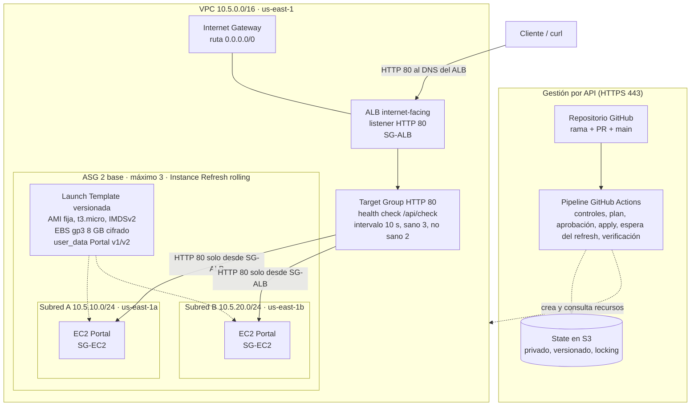

# NexoAndes - U2: Portal Operacional en AWS con actualización inmutable (IaC)

Infraestructura como código (Terraform) que despliega el Portal Operacional NexoAndes en AWS con un ALB y un grupo de EC2, y lo actualiza de v1 a v2 por reemplazo con recuperación ensayada. Evaluación Sumativa U2 - Automatización de Infraestructura con IaC (IC106TICL).

## Identificación

| Dato | Valor |
|---|---|
| Proyecto / fase | NexoAndes / U2 |
| X | 5 (número de lista; el docente no asignó otro) |
| Alumno / curso | a005 / c01 |
| Prefijo de nombres | `na-u2-c01-a005` + sufijo por recurso (`-aws-vpc`, `-aws-alb`, `-aws-asg`, etc.) |
| Tags | `proyecto=NexoAndes`, `fase=U2`, `alumno=a005`, `curso=c01`, `proveedor=aws` |
| Región | us-east-1 (laboratorio AWS Academy) |
| Alcance | Todo en AWS, según indicación del docente |

## Diagrama de la implementación



Línea continua: tráfico HTTP del Portal. Línea punteada: gestión y asociación. El endpoint de servicio es el DNS del ALB, no la IP de una EC2. No hay SSH abierto ni conectividad con otra nube.

## Estructura del repositorio

```text
.
|-- .github/workflows/terraform.yml   Pipeline
|-- .gitignore / .gitattributes
|-- .trivyignore                      Excepciones justificadas de Trivy
|-- README.md
`-- terraform/
    |-- versions.tf / providers.tf    Versiones y provider AWS
    |-- backend.tf / backend.hcl      State remoto en S3 con locking (sin credenciales)
    |-- variables.tf / outputs.tf     Entradas con validación y salidas
    |-- main.tf                       locals, templatefile() y composición de módulos
    |-- u2.tfvars                     Identidad y versión (sin secretos)
    |-- .terraform.lock.hcl           Bloqueo de providers
    |-- templates/user_data_u2.sh.tpl Bootstrap del docente (v1/v2 por variable)
    |-- tests/u2.tftest.hcl           Pruebas IaC (direccionamiento, IMDSv2, versiones)
    `-- modules/
        |-- network/                  VPC, subredes A y B, IGW, rutas
        |-- security/                 SG del ALB y SG de las EC2
        |-- alb/                      ALB, Target Group y listener
        `-- compute/                  Launch Template y ASG con Instance Refresh
```

## Composición de módulos

`network` expone `vpc_id` y `subnet_ids`. `security` recibe `vpc_id` y entrega los dos SG. `alb` recibe red y SG del ALB y entrega `target_group_arn`. `compute` recibe subredes, SG de las EC2, `target_group_arn` y el `user_data` renderizado. `compute` declara `depends_on = [module.network]` para que la ruta a Internet exista antes del bootstrap.

## Recursos y reglas de red

- VPC `10.X.0.0/16`, subred A `10.X.10.0/24` y subred B `10.X.20.0/24` en zonas distintas (con X=5: `10.5.0.0/16`, `10.5.10.0/24`, `10.5.20.0/24`).
- SG del ALB: entrada HTTP 80 desde el CIDR autorizado; salida solo hacia el SG de las EC2.
- SG de las EC2: entrada HTTP 80 solo desde el SG del ALB; salida 443 y 80 para el bootstrap. Sin SSH.
- Launch Template: AMI fija, `t3.micro`, IMDSv2 obligatorio, disco gp3 de 8 GB cifrado y eliminado al terminar la instancia.
- ASG: `min = desired = 2`, `max = 3`, health check de tipo ELB y `wait_for_elb_capacity` igual a la capacidad base.

## E01 - Equivalencias AWS/Azure y límites

Solo AWS está implementado. La tabla compara conceptos y no representa Azure en el diagrama.

| Función | AWS (implementado) | Azure (equivalente) | Diferencias y límites |
|---|---|---|---|
| Entrada de tráfico | Application Load Balancer: listener HTTP 80, regla hacia un Target Group, health check HTTP | Application Gateway (capa 7) o Azure Load Balancer (capa 4) | El ALB exige subredes en al menos dos zonas y se asocia a SG. Application Gateway usa una subred dedicada y un probe propio, y se protege con NSG. El ALB no se configura con IP pública fija: su endpoint es el DNS. |
| Cómputo reemplazable | Launch Template + Auto Scaling Group con Instance Refresh | Virtual Machine Scale Set con modelo de VM y política de actualización | El ASG reemplaza instancias con una plantilla versionada y respeta `min/max_healthy_percentage`. El VMSS necesita señal de salud (probe o extensión) para actualizar en rolling. Aquí el ASG mantiene una capacidad base fija, no autoescala. |

- Identidad y destino: cuenta del laboratorio AWS Academy con el rol `voclabs`, región us-east-1.
- Permisos: los que concede el laboratorio; se comprobó antes de escribir código que permite crear VPC y bucket.
- Cuota y presupuesto: instancias `t3.micro` y un máximo de 3 simultáneas, con el crédito del laboratorio. Los recursos se destruyen al cerrar.
- Decisión: ALB + ASG porque el Portal es una carga web sin estado, y el ALB entrega salud por destino y drenaje al retirar instancias.

## E04 - Definición inmutable

- Artefactos: una plantilla única `user_data_u2.sh.tpl` entregada por el docente. La versión se elige con `portal_version` (`v1` o `v2`) y se identifica con `build_ref` (por ejemplo `u2-v1`).
- Dependencias fijas: AMI `ami-065101b35d4f06f41` (Amazon Linux 2023) y providers bloqueados en `.terraform.lock.hcl`.
- Plantilla de cómputo: Launch Template; el ASG usa su `latest_version`, así cada cambio de versión crea una versión numerada nueva y se puede relacionar con v1/v2.
- Inmutabilidad: las instancias no se parchean. Un cambio de versión cambia el `user_data`, genera una versión nueva de la plantilla y el Instance Refresh reemplaza las instancias por otras nuevas.
- Persistencia: el Portal no guarda datos de negocio; el disco se elimina con la instancia. Todo lo reemplazable es la EC2 y su disco. El state y los artefactos viven fuera de las instancias.
- Responsabilidades: Terraform aprovisiona la infraestructura; el bootstrap (`user_data`) configura el Portal; el ASG y el ALB mantienen la capacidad y la salud.

## E04 - Estrategias comparadas

| Criterio | Rolling con Instance Refresh (elegida) | Blue-green (segundo ASG/TG) | Canary |
|---|---|---|---|
| Compatibilidad | Nativa del ASG; un solo controlador | Exige duplicar ASG y Target Group y cambiar el listener | Exige ponderar tráfico entre dos Target Groups |
| Capacidad | Base 2, temporal hasta 3 (150 %) | Doble capacidad durante el cambio | Base más un destino adicional |
| Seguridad | Mismos SG y plantilla | Mismos SG, más recursos que proteger | Igual, con más recursos |
| Costo | Bajo: una instancia extra temporal | Alto: duplica instancias | Medio |
| Riesgo | Mezcla v1/v2 durante la transición; se detiene con la señal de fallo | Retorno inmediato cambiando el listener; más piezas que fallar | Exposición parcial; requiere más observación |

Elección: rolling, porque se ajusta al cupo del laboratorio y al ASG ya compuesto. Cambiaría a blue-green si se exigiera retorno instantáneo sin mezcla de versiones y el presupuesto lo permitiera.

## E04 - Plan previo al cambio v1 a v2

**Controlador único:** Instance Refresh del ASG, lanzado por el pipeline al aplicar el cambio de `portal_version` y `build_ref`. No se modifica nada a mano durante la ventana.

**Capacidad:** base fija de 2 instancias sanas en servicio. Temporal: hasta 3 durante el reemplazo (`max_healthy_percentage = 150`, `min_healthy_percentage = 100`, `instance_warmup = 120`).

**Aceptación** (todas deben cumplirse):
- Ventana completa: desde 60 s antes del inicio hasta 120 s después de estabilizar, con separación entre muestras HTTP no mayor de 7 s.
- Cero fallos funcionales: ningún timeout, error, HTTP distinto de 200 ni respuesta con identidad o versión incorrecta.
- Capacidad comprobada con consultas al proveedor: al menos 2 destinos sanos en el Target Group en todo momento.
- Estabilización: Instance Refresh terminado con resultado esperado, destinos activos sanos y versión v2 en todos los destinos que reciben tráfico. Durante la transición se admite v1/v2; después, solo v2.

**Señales de fallo:** timeout de 5 s, HTTP distinto de 200, identidad o versión incorrecta, menos de 2 destinos sanos, o Instance Refresh en estado fallido o cancelado.

**Detención:** ante una señal de fallo se cancela el Instance Refresh desde el pipeline y se registra la hora UTC y la decisión. Los fallos quedan en el registro; si se corrige, se conserva el intento y se realiza otro ensayo completo.

**Recuperación:** retorno a v1 después de terminar, mediante otra operación: se vuelve a `portal_version = v1` y `build_ref = u2-v1` (AMI y plantilla fijas), se genera una versión nueva de la plantilla y un nuevo Instance Refresh. No se describe como rollback de una operación activa. Requisitos: pipeline operativo, state accesible y capacidad base sana antes de iniciar. Después se ejecuta un plan posterior sin cambios pendientes y se alinea el código con la decisión.

**Observación:**
- Mismo endpoint (DNS del ALB), petición cada 2 s con timeout de 5 s y sin reintentos.
- Registro de horas UTC y cadencia real.
- Capacidad y estado del controlador consultados cada 30 s como máximo, con comprobaciones cerca de ambos límites.
- Las instancias en reserva sin tráfico no se cuentan como destinos activos.

## Pipeline (GitHub Actions)

Controles (`terraform fmt -check`, `validate`, `terraform test`, TFLint, Trivy) -> plan guardado -> aprobación manual en el environment `aprobacion` -> apply del plan aprobado -> espera del Instance Refresh hasta su resultado final -> verificación (outputs, consulta AWS CLI, HTTP y plan posterior sin cambios). Los jobs que usan AWS se activan con la variable `AWS_HABILITADO`.

## State, autenticación y secretos

- State remoto en un bucket S3 privado con versionado y bloqueo (`use_lockfile`). Nunca se versiona en Git.
- Credenciales temporales del laboratorio como GitHub Secrets. No hay credenciales en el código, el repositorio ni el ZIP.

## Despliegue y limpieza

1. Cambios por rama y pull request, con los controles en verde antes del merge.
2. El push a `main` ejecuta el pipeline con aprobación manual.
3. Al cerrar: verificar el estado final, ejecutar `destroy` desde el pipeline y comprobar la limpieza con consultas independientes a AWS. No se dejan recursos encendidos para la revisión.

## Decisiones

- X=5 (número de lista) declarado por falta de asignación del docente.
- Rolling con Instance Refresh como estrategia, justificada arriba.
- Capacidad base fija; `max_capacity = 3` solo permite la capacidad temporal del reemplazo, no hay autoescalamiento.
- Sin SSH: la gestión es por API y el Portal se prueba por el DNS del ALB.

## Referencias

HashiCorp. (s. f.). *Terraform documentation*. https://developer.hashicorp.com/terraform

Amazon Web Services. (s. f.). *Amazon EC2 Auto Scaling: Instance Refresh*. https://docs.aws.amazon.com/autoscaling/ec2/userguide/asg-instance-refresh.html

Instituto Profesional San Sebastián. (2026). *Evaluación Sumativa U2: Automatización de Infraestructura con IaC (IC106TICL)*.

## Declaración de uso de IA

Herramienta: Claude (Anthropic). Propósito: apoyo en la revisión del código y en la redacción de este README. Las decisiones, la ejecución y la verificación en AWS son propias.